# ZiniPay 🪙🤖

> **100% NEAR-Aligned Constrained Agent Layer for Community Treasuries**  
> *Proof + Policy + Human Quorum* — Powered by **NEAR AI Cloud**, **NEAR Intents**, and **Sputnik DAO / Trezu** *(Chain Signatures planned)*.

[](https://near.org)
[](https://trezu.org)
[](https://github.com/near-daos/sputnik-dao-contract)
[](https://near-intents.org)

---

## 💡 The Core Thesis (NEAR in 2026)

NEAR in 2026 is the commerce and settlement layer for assets and autonomous agents.

Communities already use **[Trezu](https://trezu.org)** (built on **[Sputnik DAO v2](https://github.com/near-daos/sputnik-dao-contract)**) for multi-sig shared treasuries, roles, and payouts. 

**ZiniPay does not rebuild the multisig.** It builds what communities actually do with it: **an autonomous, constrained agent release layer** where AI agents propose and audit contributor rewards and contractor disbursements under strict, human-set policy guardrails.

The agent operates strictly under the **Requestor role**—it can only file proposals for human multi-sig review and cannot execute payouts unilaterally.

---

## 🎯 Hackathon Tracks

| Track | Qualification & Impact |
|---|---|
| 🏦 **Social Money** *(Primary)* | Shared budgets, programmable rewards, reputation-gated access tiers, on-chain policy verification, and collective governance on Sputnik DAO & Trezu. |
| 🛡️ **AI Security & Defense** *(Secondary)* | **Three-Way Match verification**, spend limits, per-recipient cooldowns, canonical anti-replay normalization, prompt-injection defense, and fail-closed deliberation. |

---

## ⚡ The Three-Way Release Gate

ZiniPay enforces a **Three-Way Match** before any proposal can reach the DAO:

```
┌────────────────────────────────────────────────────────────────────────┐
│                     ZINIPAY THREE-WAY RELEASE GATE                     │
├────────────────────────────────────────────────────────────────────────┤
│  Gate 01: Verifiable Proof   │ Deliverable IPFS CID / Git PR pinned    │
│  Gate 02: On-Chain Policy    │ Spend cap ≤ limit, cooldown, anti-replay│
│  Gate 03: Human Quorum       │ Sputnik DAO / Trezu council votes       │
└────────────────────────────────────────────────────────────────────────┘
```

### 🤝 Multi-Agent Deliberation Pipeline

Rather than relying on a single prompt, two specialized agents deliberate via **NEAR AI Cloud inference**:
1. **Inspector Agent**: Audits deliverable completeness, inspects artifact links/CIDs, and scores technical depth (0–100).
2. **Risk Arbiter Agent**: Evaluates treasury exposure, checks recipient history, and assigns **Reputation Tiers**.
3. **Consensus Engine**: If both approve, an immutable attestation is generated and submitted on-chain via `add_proposal`.

---

## 🏆 Contributor Reputation Tiers

Reputation dynamically gates payout parameters without manual admin overhead:

| Tier | Reputation Score | Proposal Cap Multiplier | Reward Bonus | Approval Workflow |
|---|---|---|---|---|
| **Bronze** | 0 – 19 pts | **1.0x** (Base: 10 NEAR) | 1.0x | Mandatory Human Multi-Sig Vote |
| **Silver** | 20 – 59 pts | **1.5x** (15 NEAR) | 1.1x | Fast-Track Review |
| **Gold** | 60+ pts | **2.0x** (20 NEAR) | 1.25x | Standard Council Quorum (Auto-Clearing Planned) |

---

## 🏗️ Architecture

```mermaid
flowchart LR
    subgraph Community ["Community & Contributors"]
        C[Contributor] -->|1. Submit Work + Evidence| CLI[ZiniPay Agent CLI / UI]
    end

    subgraph Deliberation ["NEAR AI Cloud Deliberation"]
        CLI -->|2. Technical Audit| INSP["Inspector Agent\n(Score & Artifact Check)"]
        CLI -->|2. Financial Guardrail| RISK["Risk Arbiter Agent\n(Exposure & Tier Scaling)"]
        INSP --> CONSENSUS["Consensus Engine\n(Three-Way Match Attestation)"]
        RISK --> CONSENSUS
    end

    subgraph Security ["Policy & Anti-Replay Guardrails"]
        CONSENSUS -->|3. Policy Clearance| DB[("Ledger & PolicyHelper\nCaps, Cooldowns, CIDs")]
        CONSENSUS -->|4. Function-Call Key| DAO["Sputnik DAO v2 Contract\n(add_proposal + Bond)"]
    end

    subgraph Trezu ["Trezu Multisig Governance"]
        DAO -->|5. Appears in Dashboard| TREZU["Trezu Workspace UI"]
        TREZU -->|6. Human Council Vote| COUNCIL["Finance / Governance Roles\n(Approve / Override)"]
    end

    subgraph Settlement ["Settlement Rails"]
        COUNCIL -->|Native NEAR| WALLET["Contributor NEAR Account"]
        COUNCIL -->|Cross-Chain Route| INTENTS["NEAR Intents 1Click API\n(Settles to ETH / SOL / BTC)"]
    end
```



---

## 🚀 "Do X, See Y" Quickstart (Try in 60 Seconds)

### 1. Install & Build Monorepo
```bash
git clone https://github.com/kellycryptos/ZiniPay.git
cd ZiniPay
npm install
npm run build
```

### 2. Run a Dry-Run Proposal (Instant Verification)
Test the complete policy clearance, multi-agent deliberation, and Three-Way Match without needing testnet funds:

```bash
npm run agent:propose -- propose \
  --task "Build Sputnik DAO Three-Way Match Agent" \
  --deliverable "https://github.com/zinipay/core/pull/1" \
  --recipient "alice.testnet" \
  --amount 4.5 \
  --dry-run
```

**Expected Output:**
```text
🪙🤖 ZiniPay — Multi-Agent Deliberation & Constrained Release

  Task:        Build Sputnik DAO Three-Way Match Agent
  Deliverable: https://github.com/zinipay/core/pull/1
  Recipient:   alice.testnet [Tier: Bronze | Score: 0.0]
  Requested:   4.5 NEAR (Multiplier: 1x)

[1/4] Running Three-Way Match Policy Clearance...
  ✓ Match A: Deliverable proof attached
  ✓ Match B: Stayed under Bronze tier cap (10 NEAR max)
  ✓ Match C: Zero-replay confirmed (deliverable not previously paid)

[2/4] Executing Multi-Agent Deliberation via NEAR AI Cloud (Inspector + Risk Arbiter)...
  Inspector Agent:   Score 95/100 — "Artifact verified with active link & scope match"
  Risk Arbiter:      Risk LOW — "Contributor tier Bronze qualifies under spend caps"
  Consensus Verdict: APPROVED (Confidence: 95%)

[3/4] Constructing Constrained Proposal for Sputnik DAO / Trezu...
  On-chain Description: "[Three-Way Match: 3/3 PASS] [Tier: Bronze] Artifact verified with active link & scope match | Deliverable: https://github.com/zinipay/core/pull/1 | Confidence: 95%"
  ✓ Three-Way Match attestation attached

[4/4] Submitting to DAO Treasury (Requestor role)...
  ✓ THREE-WAY MATCH & DELIBERATION VERIFIED: Ready for live Sputnik DAO / Trezu submission!
```

### 3. Test Cross-Chain Intent Settlement
```bash
npm run agent:propose -- propose \
  --task "Audited Solana Relayer Integration" \
  --deliverable "ipfs://bafybeigdyrzt5sfp7udm7hu76uh7y26nf3efuylqabf3oclgtqy55fbzdi" \
  --recipient "solana-dev.testnet" \
  --amount 8 \
  --cross-chain "solana" \
  --cross-chain-address "9xQe...3vK" \
  --dry-run
```

### 4. Run the Community Frontend Dashboard
```bash
npm run frontend:dev
```
Open [http://localhost:5173](http://localhost:5173) in your browser to view live proposals, inspect Three-Way Release Gate status, and dispatch agent proposals.

---

## 🧪 Verified on testnet

ZiniPay includes an automated, end-to-end verification script (`scripts/e2e-testnet.mjs`) that executes the complete on-chain lifecycle:
1. Connects to NEAR Testnet RPC (`https://rpc.testnet.near.org`)
2. Inspects Sputnik DAO v2 governance policy and proposal bonds
3. Dispatches a real proposal signed by the agent with Three-Way Match attestation
4. Casts a human council approval vote (`VoteApprove`)
5. Verifies on-chain proposal state transition to `Approved`

### Running the End-to-End Testnet Script

Set your funded testnet credentials in `agent/.env` or export them:
```bash
export AGENT_ACCOUNT_ID="your-agent.testnet"
export AGENT_PRIVATE_KEY="ed25519:..."
export COUNCIL_ACCOUNT_ID="your-council.testnet"
export COUNCIL_PRIVATE_KEY="ed25519:..."
export DAO_CONTRACT_ID="your-dao.sputnik-dao.testnet"
# Optional: on-chain policy helper contract
export POLICY_CONTRACT_ID="policy.your-dao.testnet"

npm run test:e2e
```

> **Verification Status & On-Chain Audit:**  
> In accordance with hackathon anti-fabrication rules, transaction hashes are printed from live network execution only. If executed without live credentials, the script halts with an explicit error and code `1`. When run with your funded testnet accounts, the script outputs the exact NEARBlocks explorer links for both the proposal submission and council approval transactions.

---

## 🛠️ Project Structure

```
zinipay/
├── contracts/
│   ├── policy-helper/             # Rust NEAR contract: Caps, cooldowns, CIDs, reputation
│   └── README.md                  # Sputnik DAO v2 ABI reference
├── agent/                         # Multi-Agent Deliberation & Policy Engine (TypeScript)
│   ├── src/
│   │   ├── index.ts               # CLI runner & proposal dispatcher
│   │   ├── dao.ts                 # Sputnik DAO v2 near-api-js wrapper
│   │   ├── deliberation.ts        # Inspector + Risk Arbiter multi-agent engine (NEAR AI Cloud)
│   │   ├── policy.ts              # Three-Way Match & spend policy engine
│   │   ├── reputation.ts          # Tiered contributor ledger (Bronze/Silver/Gold)
│   │   └── intents.ts             # NEAR Intents 1Click cross-chain wrapper
│   ├── .env.example               # Configuration template
│   └── package.json
├── frontend/                      # React / Vite / Tailwind Dashboard
│   ├── src/
│   │   ├── App.tsx                # Main treasury workspace view
│   │   ├── components/
│   │   │   ├── ThreeWayGate.tsx   # Three-Way Release Gate visualizer
│   │   │   ├── ProposalCard.tsx   # Three-Way Match cards & vote indicators
│   │   │   └── PolicyPanel.tsx    # Daily spend gauges & reputation tiers
│   │   └── hooks/
│   │       └── useNearDao.ts      # Native NEAR JSON-RPC live query hook
│   └── package.json
├── scripts/
│   └── setup-testnet.mjs          # Interactive testnet key & DAO creator
└── README.md
```

---

## 🔒 Security & Key Custody

ZiniPay enforces strict non-custodial constraints:
1. **Proposer Role Isolation**: The agent only holds permissions to call `add_proposal` (via a dedicated funded proposer account or a 0-bond restricted function-call key). It holds zero access keys to the DAO treasury account and cannot execute transfers unilaterally.
2. **Cannot Vote**: The agent does not belong to Council/Finance voting groups—human multi-sig signers must review and approve proposals.
3. **Anti-Replay Enforced**: Deliverables are canonically normalized and checked both off-chain in lowdb and on-chain in `PolicyHelper` so identical PRs or CIDs cannot be rewarded twice.
4. **Deterministic Cooldowns & Tier Caps**: Rolling limits and reputation multipliers prevent proposal floods and enforce spending bounds.

---

## 📄 License
MIT
